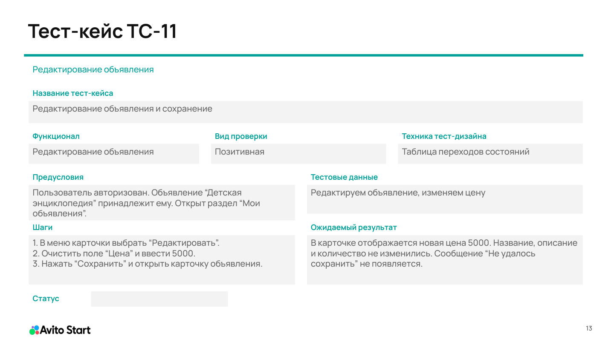
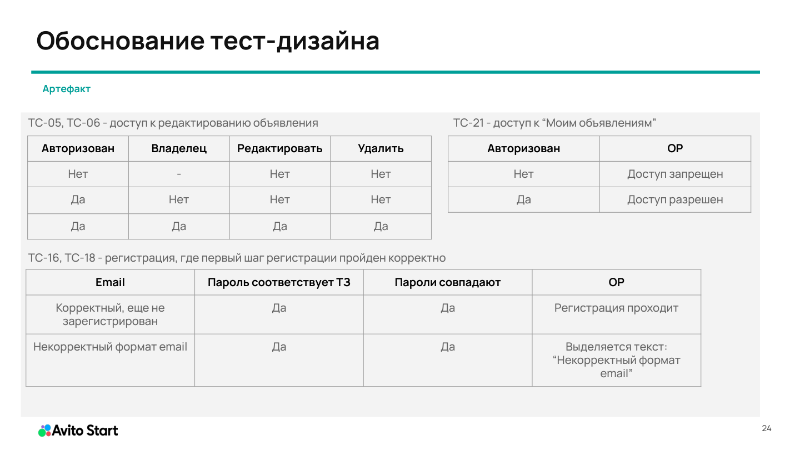

# TestBoard — ручное тестирование сервиса объявлений

Учебный QA-проект, подготовленный в рамках обучения QA в Авито. Работа посвящена проектированию ручных UI-проверок по требованиям и макетам веб-сервиса объявлений.

**21 тест-кейс · 11 позитивных · 10 негативных · 4 техники тест-дизайна**

## Что проверяется

| Функциональность | Проверки | Тест-кейсы |
| --- | --- | --- |
| Поиск и сортировка | Релевантная выдача, регистронезависимость, отсутствие результатов, порядок цен | TC-01–TC-03 |
| Карточка объявления | Отображение данных, доступность кнопок для гостя, владельца и другого пользователя | TC-04–TC-06 |
| Создание объявления | Публикация, обязательные поля, длина описания | TC-07–TC-09 |
| Редактирование и удаление | Сохранение новой цены, отказ при пустом названии, подтверждение удаления | TC-10–TC-12 |
| Вход | Корректные данные, незарегистрированный email, короткий пароль, переходы между экранами | TC-13–TC-15 |
| Регистрация | Успешная регистрация, граница длины пароля, некорректный email | TC-16–TC-18 |
| Профиль и личные объявления | Выход, данные профиля, собственные объявления, пустой список, доступ по прямой ссылке | TC-19–TC-21 |

## Документация

- [Тест-кейсы](test-cases.md) — предусловия, конкретные данные, шаги и ожидаемые результаты.
- [Тест-дизайн](test-design.md) — классы эквивалентности, граничные значения, таблицы решений и переходов состояний с привязкой к кейсам.
- [Открытые вопросы и допущения](drequirements-notes.md) — вопросы к требованиям, влияющие на ожидаемое поведение.
- [Исходная презентация](testboard-test-cases-source.pdf) — учебная работа в PDF.
- [Изменения при подготовке портфолио](CHANGELOG.md).

Актуальная версия кейсов находится в Markdown. Исходный PDF сохранён как отдельный учебный артефакт; уточнения из Markdown перечислены в журнале изменений.

## Примеры артефактов

Пример карточки тест-кейса из исходной презентации:

Пример таблицы решений из исходной презентации:

## Подход к тест-дизайну

| Техника | Для чего используется | Пример |
| --- | --- | --- |
| Классы эквивалентности | Выбор представителей групп данных с одинаковым ожидаемым поведением | Поисковый запрос с совпадениями и без совпадений |
| Анализ граничных значений | Проверка значений около ограничения | Описание: 499/500/501 символ; пароль: 7/8/9 символов |
| Таблицы решений | Проверка результата при сочетании нескольких условий | Авторизация и принадлежность объявления пользователю |
| Переходы состояний | Проверка изменения состояния после действия | Открытие подтверждения удаления, удаление, выход из аккаунта |

При подготовке негативных данных выделяется проверяемое условие. Например, для незарегистрированного email используется пароль достаточной длины, а при проверке длины пароля сохраняются заглавная буква, строчные буквы и цифры.

## Основа проекта

- [Требования к TestBoard](https://docs.google.com/document/d/1IZ9SxEcePoQT6lyEmukycp1qNok4HZtok73UQnPwKSA/edit)
- [Макеты TestBoard в Figma](https://www.figma.com/design/Cpp1I80K2KyiFwQTlZN8hU/TestBoard2?node-id=0-1)

Для просмотра работы достаточно открыть Markdown-документы или PDF. Для выполнения кейсов требуется тестовое окружение TestBoard с подготовленными данными; доступность ссылок на учебные материалы зависит от настроек их владельцев.

В документации приведены ожидаемые результаты. Статусы выполнения в исходном задании оставлены пустыми согласно требованиям шаблона.

## Автор

**@juciewr1d** — студент МГТУ им. Н. Э. Баумана, обучение QA в Авито.
